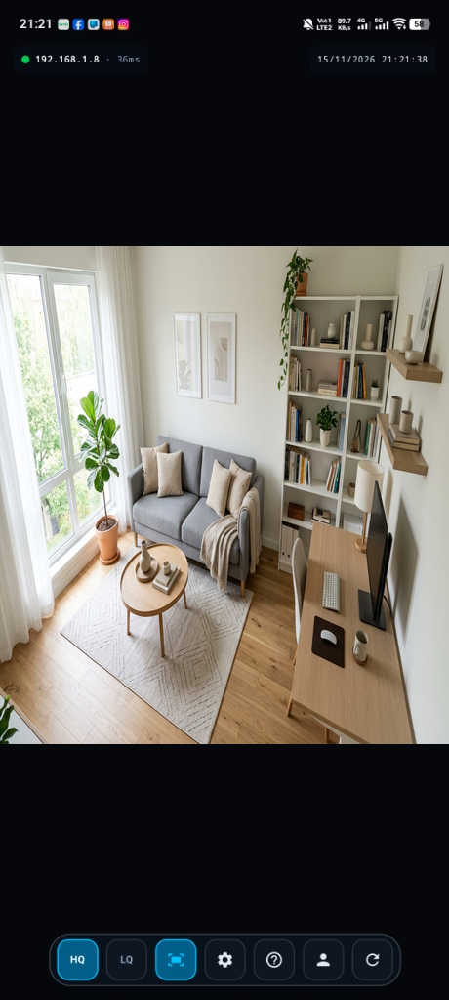
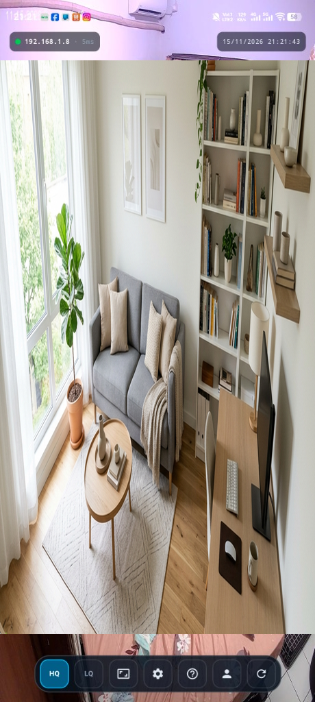
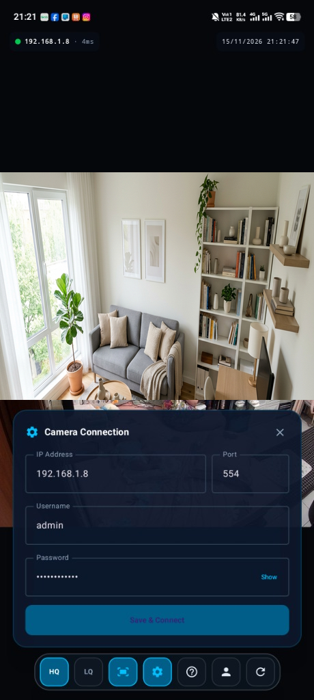
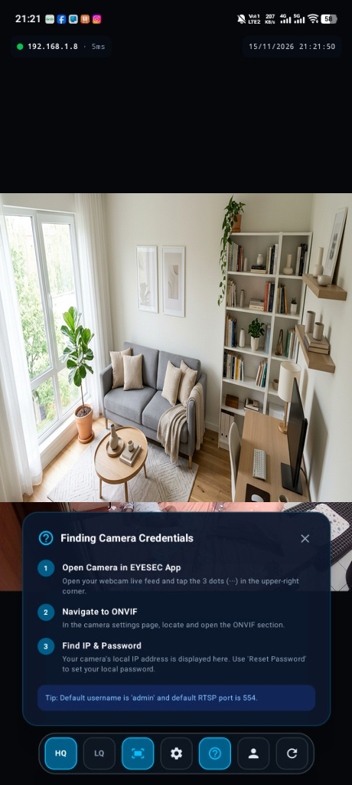
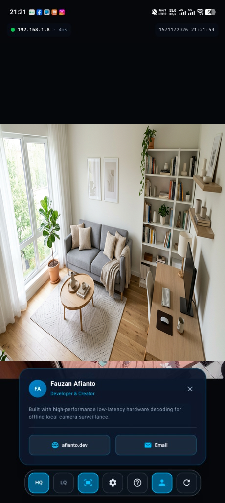

<div align="center">

# EYESEC Android Viewer Offline

**An offline-first, ultra-low latency RTSP camera viewer for Android built with Kotlin, Jetpack Compose, and native hardware MediaCodec.**

[](https://developer.android.com/jetpack/compose)
[](https://kotlinlang.org/)
[](https://developer.android.com/reference/android/media/MediaCodec)
[](https://opensource.org/licenses/MIT)
[](https://github.com/thearticle/EYESEC-Android-Viewer-Offline/releases/latest)
[](https://developer.android.com)

<p align="center">
  <a href="#-overview">Overview</a> •
  <a href="#-screenshots--ui-showcase">Screenshots</a> •
  <a href="#-key-features">Key Features</a> •
  <a href="#-releases--apk-downloads">Releases (APKs)</a> •
  <a href="#-how-to-find-camera-ip--credentials">Camera Setup Guide</a> •
  <a href="#-technical-architecture">Architecture</a> •
  <a href="#-tech-stack">Tech Stack</a> •
  <a href="#-getting-started">Getting Started</a> •
  <a href="#-author--credits">Author & Credits</a>
</p>

</div>

---

## 📖 Overview

**EYESEC Android Viewer Offline** is a standalone, privacy-first mobile CCTV monitor designed for compatible EYESEC and ONVIF RTSP security cameras.

Unlike vendor cloud apps that route camera streams through remote servers with subscription fees, privacy compromises, and internet lag, **EYESEC Android Viewer Offline** streams directly from your camera to your Android phone or tablet over your local Wi-Fi or Ethernet network (LAN). It delivers real-time monitoring with virtually zero latency even when your home or office internet connection is completely offline.

---

## 📱 Screenshots & UI Showcase

<div align="center">
  <table>
    <tr>
      <td align="center" width="33%"><b>1. Aspect-Ratio Fit Mode</b></td>
      <td align="center" width="33%"><b>2. Fullscreen Stretch Mode</b></td>
      <td align="center" width="33%"><b>3. Camera Connection Card</b></td>
    </tr>
    <tr>
      <td align="center"></td>
      <td align="center"></td>
      <td align="center"></td>
    </tr>
    <tr>
      <td align="center" width="33%"><b>4. Illustrated Setup Help</b></td>
      <td align="center" width="33%"><b>5. In-App Developer Credits</b></td>
      <td align="center" width="33%"><b>6. Symmetrical Floating HUD</b></td>
    </tr>
    <tr>
      <td align="center"></td>
      <td align="center"></td>
      <td align="center"></td>
    </tr>
  </table>
</div>

---

## ✨ Key Features

- ⚡ **Direct Hardware Decoding (`MediaCodec`)**: Incoming H.264 NAL units bypass heavy multi-codec software libraries and feed directly into the phone's native hardware decoder chip for ~20ms decoding latency and minimal battery consumption.
- 🎛️ **Dual Stream Quality Toggle (`HQ` / `LQ`)**: Seamlessly switch between `/1/h264major` (High Definition) and `/1/h264minor` (Low Bandwidth) on the fly without stream crashes or image corruption.
- 🔍 **Interactive 6x Pinch-to-Zoom & Pan**: Full 2D gesture navigation. Pinch to zoom up to 6x around your touch point, drag to pan across the scene, and double-tap to reset or jump to 2.5x.
- ↔️ **Screen Mode Toggle**: Instantly switch between **Aspect-Ratio Fit** (preserving true camera proportions) and **Stretch to Fill** (taking advantage of your entire phone display).
- ⏱️ **Real-Time Network Diagnostics & HUD**: Live camera ping latency monitor (`ms`), TCP connection health indicator dot, and synchronized CCTV timestamp watermark.
- 🪟 **Floating Glass UI Architecture**: Sleek dark-glass floating controls (42×42dp uniform squircle buttons) with quick-access floating modal cards positioned cleanly above the bar:
  - ⚙️ **Camera Connection**: Fast configuration for IP, RTSP port (554), username, and password with toggleable visibility.
  - ❓ **Illustrated Setup Help**: Step-by-step guidance on locating the ONVIF IP and password.
  - 👤 **Developer Credits**: Quick interactive links to developer portfolio and email.
- 🛡️ **Offline & 100% Private**: Zero external analytics, cloud servers, or third-party tracking. All credentials persist securely on your device.

---

## 📦 Releases & APK Downloads

Pre-built binaries are available under [GitHub Releases](https://github.com/thearticle/EYESEC-Android-Viewer-Offline/releases/latest):

| APK Package | Architecture | Size | Recommendation |
|:---|:---|:---:|:---|
| **`app-arm64-v8a-debug.apk`** | 64-bit ARM (`arm64-v8a`) | ~23 MB | **Recommended for all modern Android phones/tablets** (Samsung, Xiaomi, Pixel, Oppo, Vivo, etc.) |
| **`app-armeabi-v7a-debug.apk`** | 32-bit ARM (`armeabi-v7a`) | ~23 MB | For older 32-bit Android hardware |
| **`app-universal-debug.apk`** | Universal (All ABIs) | ~23 MB | Fallback compatible with any physical device |

> **Direct Installation via ADB:**
> ```bash
> adb install -r app-arm64-v8a-debug.apk
> ```

---

## 🔍 How to Find Camera IP & Credentials

For compatible EYESEC and ONVIF cameras:

1. **Open Camera Feed**: Open your camera's live view in the **EYESEC** mobile app.
2. **Settings**: Tap the **three dots (⋯)** in the upper-right corner of the live feed.
3. **Navigate to ONVIF**: Open the **ONVIF** menu and ensure the switch is toggled **ON**.
4. **Retrieve Local IP**: Your local camera IP address (e.g., `192.168.1.57`) is displayed on this screen.
5. **Set Password**: Use the **Reset Password** option to define your local RTSP password.
6. **Connect**: In EYESEC Android Viewer, enter the camera's IP, use port **`554`**, username **`admin`**, and your password.

---

## 🏗️ Technical Architecture

```text
EYESEC Camera ── RTSP / RTP over TCP ── Local Wi-Fi (LAN) ── Android MediaCodec HW Decoder ── Screen
```

- **RTSP Handshake**: Forces RTP-over-TCP (`Interleaved RTSP`) to prevent UDP packet loss and firewall drops.
- **Zero-Buffering Queue**: Frames are presented immediately upon arrival rather than queued in large multi-second buffers.
- **Teardown Safety**: Implements a 250ms hardware unbind window when switching streams or credentials, preventing `MediaCodec` memory leaks or decoder stalls.

---

## 🛠️ Tech Stack

| Category | Technologies |
|---|---|
| **Language** | [Kotlin 2.0+](https://kotlinlang.org/) |
| **UI Framework** | [Jetpack Compose](https://developer.android.com/jetpack/compose) (Material 3) |
| **Video Decoding** | Android Native [MediaCodec](https://developer.android.com/reference/android/media/MediaCodec) (Hardware AVC / H.264) |
| **RTSP Engine** | Lightweight Low-Latency RTSP Client (Zero-buffering pipeline) |
| **Build & Tooling** | Android Gradle Plugin 9.x, R8 Minification, Java 17 |

---

## 🚀 Getting Started

### Prerequisites
- Android 8.0 (API Level 26) or higher.
- A physical device or emulator on the same Wi-Fi network as the camera.

### Building from Source

1. **Clone the repository**:
   ```bash
   git clone https://github.com/thearticle/EYESEC-Android-Viewer-Offline.git
   cd EYESEC-Android-Viewer-Offline
   ```

2. **Build Debug APK**:
   ```powershell
   .\gradlew.bat assembleDebug
   ```

3. **Install to your connected device**:
   ```powershell
   adb install -r app/build/outputs/apk/debug/app-arm64-v8a-debug.apk
   ```

---

## 📂 Project Structure

```text
EYESEC-Android-Viewer-Offline/
├── app/
│   ├── src/main/
│   │   ├── kotlin/com/eyesec/viewer/
│   │   │   ├── data/            # CameraConfig & Settings Repository
│   │   │   ├── ui/player/       # PlayerScreen, ViewModel & Floating Cards
│   │   │   └── MainActivity.kt  # Root Activity
│   │   └── AndroidManifest.xml
│   ├── build.gradle.kts
│   └── proguard-rules.pro
├── gradle/
│   └── libs.versions.toml
├── build.gradle.kts
├── settings.gradle.kts
└── README.md
```

---

## 👨‍💻 Author & Credits

Created with ❤️ by **Fauzan Afianto**
- **Website**: [afianto.dev](https://afianto.dev)
- **Email**: [fauzan@afianto.dev](mailto:fauzan@afianto.dev)
- **GitHub**: [@thearticle](https://github.com/thearticle)

---

## 📄 License

This project is licensed under the [MIT License](LICENSE).
